# Hi, I'm Richards 👋

### Aspiring AI Automation Engineer | Python | n8n | AI-Powered Business Automation

I build practical automation systems that help businesses streamline operations, reduce repetitive tasks, and make better use of AI.

My background includes five years of experience as a Banking Relationship Manager, where I developed an understanding of customer relationships, business operations, and financial processes. I'm now combining that experience with Python, APIs, workflow automation, and AI tools to solve real-world business problems.

## 🧰 Technologies I Work With

  
  
  
  
  
  
  
  

## 📊 GitHub Activity

  

  

## 🚀 Featured Projects

### 1. SME Loan Pre-Screening Automation System

An AI-assisted workflow designed to automate the initial screening of small and medium-sized business loan applications.

- Collects business and loan application information.
- Evaluates application data against screening criteria.
- Uses AI to support preliminary assessment.
- Records results in Airtable.
- Sends assessment summaries through email notifications.
- Built with n8n, Groq, Airtable, and Docker.

**Technologies:** n8n | Groq API | Airtable | Docker

[View Project on GitHub](https://github.com/Richards22/sme-loan-pre-screening-system)

### 2. Python Bootcamp

A practical learning repository documenting my Python development journey, including programming fundamentals and API-related exercises.

**Technologies:** Python | REST APIs | Git | GitHub

[View Repository](https://github.com/Richards22/python-bootcamp)

## 🛠️ Technical Skills

- **Programming:** Python
- **Workflow Automation:** n8n
- **AI Integration:** Groq API, AI-assisted workflows
- **Data Management:** Airtable, CSV
- **Development Tools:** Docker, Git, GitHub, VS Code, Postman
- **API Development:** REST APIs, HTTP requests, JSON

## 🎯 What I'm Working Towards

I'm focused on becoming an AI Automation Engineer who can design and implement reliable automation systems for businesses.

My areas of interest include:

- AI agents and intelligent workflow automation
- Business process automation
- API integrations
- AI-powered business applications
- Practical automation solutions for small and medium-sized businesses

## 🤝 Let's Connect

I'm interested in connecting with automation engineers, developers, founders, and businesses exploring practical applications of AI and workflow automation.

Feel free to explore my repositories and follow my progress.
